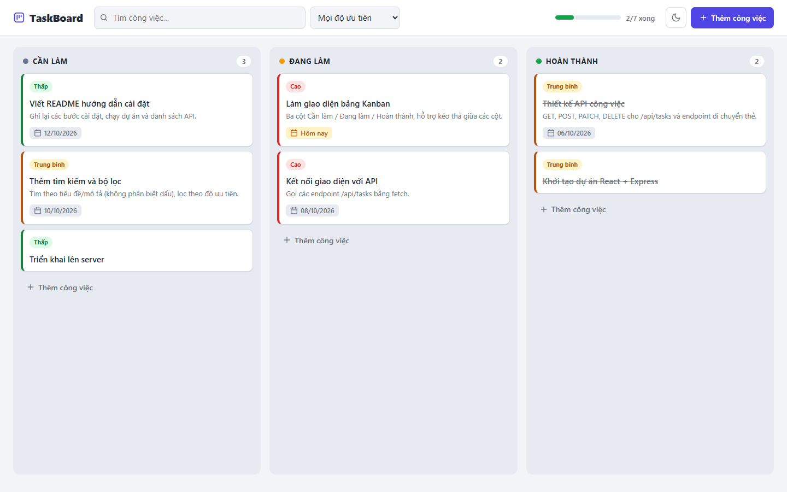
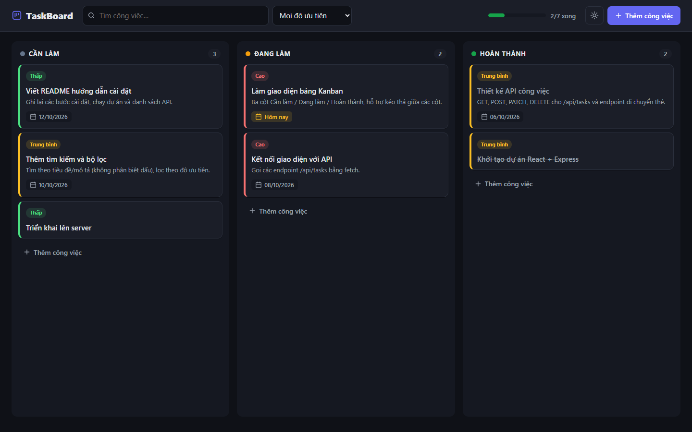

# TaskBoard – Quản lý công việc dạng Kanban

Ứng dụng web quản lý công việc theo kiểu bảng Kanban (giống Trello thu nhỏ).

- **Frontend:** React + Vite
- **Backend:** Node.js + Express (REST API)
- **Lưu trữ:** file JSON (`server/data/db.json`), không cần cài database



<details>
<summary>Giao diện tối</summary>



</details>

## Tính năng

- 3 cột **Cần làm / Đang làm / Hoàn thành**
- Thêm, sửa, xoá công việc: tiêu đề, mô tả, độ ưu tiên, hạn chót
- **Kéo thả** thẻ để đổi thứ tự hoặc chuyển cột; trên điện thoại dùng nút ← →
- Tìm kiếm **không phân biệt dấu** (gõ `thiet ke` vẫn ra "Thiết kế"), lọc theo độ ưu tiên
- Đánh dấu việc **quá hạn** và **đến hạn hôm nay**
- Thanh tiến độ, giao diện **sáng/tối**, hiển thị tốt trên điện thoại
- Server kiểm tra dữ liệu đầu vào, có bộ test API

## Yêu cầu

- [Node.js](https://nodejs.org) phiên bản 22.12 trở lên (khuyên dùng bản LTS mới nhất)

## Cách chạy

```bash
# 1. Cài thư viện (chỉ cần chạy 1 lần)
npm install

# 2. Chạy chế độ phát triển (server + giao diện cùng lúc)
npm run dev
```

Mở trình duyệt tại **http://localhost:5173**

Lần chạy đầu, server tự tạo file `server/data/db.json` với vài công việc mẫu.
Muốn làm lại từ đầu thì xoá file này rồi chạy lại.

### Các lệnh khác

| Lệnh            | Ý nghĩa                                                       |
| --------------- | ------------------------------------------------------------- |
| `npm run dev`   | Chạy server (cổng 3001) và Vite (cổng 5173), tự tải lại khi sửa code |
| `npm test`      | Chạy test cho API                                             |
| `npm run build` | Build giao diện ra `client/dist`                              |
| `npm start`     | Chạy bản production: server phục vụ cả API lẫn giao diện tại http://localhost:3001 |

## Cấu trúc thư mục

```
├── package.json            # Cấu hình chung (npm workspaces)
├── server/                 # Backend Express
│   ├── src/
│   │   ├── index.js        # Điểm khởi động server
│   │   ├── app.js          # Tạo app Express, middleware, xử lý lỗi
│   │   ├── routes/tasks.js # Các route /api/tasks
│   │   ├── store.js        # Đọc/ghi dữ liệu ra file JSON
│   │   ├── validate.js     # Kiểm tra dữ liệu gửi lên
│   │   └── seed.js         # Dữ liệu mẫu
│   └── test/api.test.js    # Test API (node:test)
└── client/                 # Frontend React + Vite
    ├── vite.config.js      # Proxy /api → http://localhost:3001
    └── src/
        ├── App.jsx         # State chính, gọi API
        ├── api.js          # Hàm gọi API bằng fetch
        ├── components/     # Header, Board, Column, TaskCard, TaskModal, Toast
        ├── hooks/          # useTheme (giao diện sáng/tối)
        ├── lib/            # Hàm xử lý (di chuyển thẻ, lọc, ngày tháng)
        └── index.css       # Giao diện
```

## API

Địa chỉ gốc: `http://localhost:3001/api`

| Method | Đường dẫn           | Mô tả                                   |
| ------ | ------------------- | --------------------------------------- |
| GET    | `/tasks`            | Lấy tất cả công việc                    |
| GET    | `/tasks/:id`        | Lấy một công việc                       |
| POST   | `/tasks`            | Tạo công việc mới                       |
| PATCH  | `/tasks/:id`        | Sửa một vài trường của công việc        |
| POST   | `/tasks/:id/move`   | Di chuyển thẻ: `{ "status": "doing", "index": 0 }` |
| DELETE | `/tasks/:id`        | Xoá công việc                           |

Một công việc có dạng:

```json
{
  "id": "7f1c2a9e-...",
  "title": "Thiết kế trang chủ",
  "description": "Làm bản mockup trước",
  "priority": "high",
  "status": "todo",
  "dueDate": "2026-10-20",
  "order": 0,
  "createdAt": "2026-10-07T08:00:00.000Z",
  "updatedAt": "2026-10-07T08:00:00.000Z"
}
```

- `priority`: `low` | `medium` | `high`
- `status`: `todo` | `doing` | `done`
- `dueDate`: `YYYY-MM-DD` hoặc `null`
- `order`: vị trí của thẻ trong cột (bắt đầu từ 0)

Khi dữ liệu không hợp lệ, server trả về mã **400** kèm thông báo lỗi:

```json
{ "error": "Tiêu đề không được để trống", "errors": ["Tiêu đề không được để trống"] }
```

## Gợi ý phát triển thêm

- Đăng nhập, mỗi người dùng có bảng riêng
- Thay file JSON bằng database (SQLite, MongoDB, PostgreSQL)
- Thêm nhãn (tag), người được giao việc, bình luận
- Cho phép tạo thêm cột tuỳ ý
